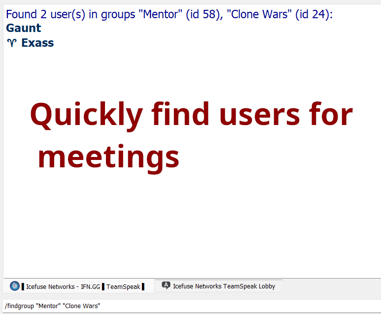
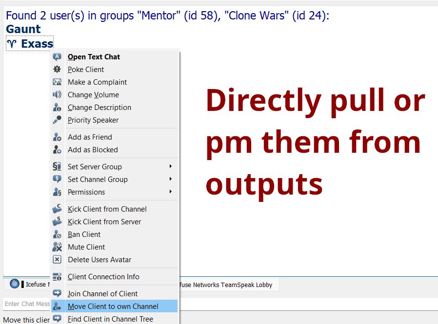
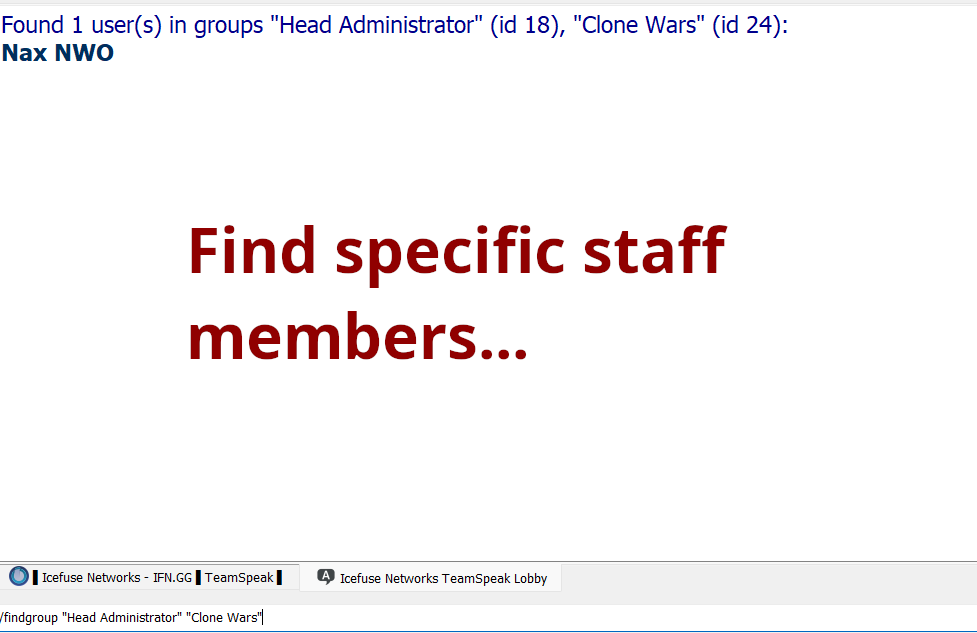
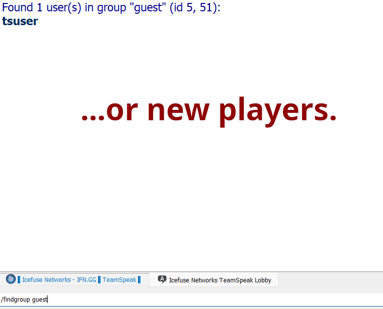

# ts3 plugin to find online users by their server groups. Made by PhysicsGaunt

Install: double-click `groupfinder-<version>.ts3_plugin` (close TeamSpeak first if an older version is loaded),
then enable **Group Finder Plugin** in *Tools → Options → Addons → Plugins*. 64-bit TeamSpeak 3 client on Windows.

## Find users by group

*Plugins → Find Users by Group…* (or a hotkey): pick a server, tick groups from that server's group list, and see
who is online in **all** ticked groups, with their channel — updated live. **Show in chat** prints the list as
clickable names; **Set as connect alarm…** turns the ticked groups into an alarm.

Or type it in a chat tab:

```
/findgroup "[group1]" "[group2]"
```

(IDs or names; names may be quoted. `/findgroup help` shows all options.)









## Connect alarm

*Plugins → Connect Alarm Settings…*: per server, switch the alarm on, tick the groups someone must be in, and pick
a WAV sound (with **Test**). When a matching user connects you hear the sound and get a clickable name in that
server's tab. The window previews who online right now would match. *Connect Alarm: Toggle* flips it on/off.

Each server has its own alarm (saved as `%APPDATA%\TS3Client\<server name>_alarm.cfg`). Chat commands still work:
`/findgroup alarm set "Head Administrator" Guest`, `/findgroup alarm on|off|status|clear`.

## Meeting scheduler

Open it from *Plugins → Meeting Scheduler…* (or the plugin's *Settings* button, or a hotkey). Add meetings with
**Add…**, or right-click any channel → **Add meeting here…**.

Each meeting has a channel, a start date and time in a chosen time zone (daylight saving handled), and a repeat
(once, every N days, weeks on chosen weekdays, or months). At the start time:

- **connected to that server** → you are moved into the channel;
- **not connected** (or on another server) → a new tab connects straight into the channel.

Choose per meeting whether that happens silently, or whether a pop-up warns you N minutes before
("starts in 1:47 — you will be moved automatically") with **Move now** / **Don't move me**. Closing the pop-up
keeps the automatic move. Meetings are stored in `%APPDATA%\TS3Client\groupfinder_meetings.ini`.

## Hotkeys

Bind them in *Options → Hotkeys → Add → Plugins → Group Finder Plugin*:

| Hotkey | Does |
|---|---|
| Open Find Users by Group | opens the group search window |
| Open meeting scheduler | opens the list window |
| Join next meeting now | moves/connects you to the next upcoming meeting right away |
| Cancel pending meeting move | skips meetings being warned about or starting within 10 minutes (this time only) |
| Toggle connect alarm | same as `/findgroup alarm on/off` |
| List online users matching alarm criteria | runs `/findgroup` with your alarm criteria |

## Building

Windows x64 only, MSVC + Qt 5.15.2 (the Qt TeamSpeak ships). From WSL: `scripts/build.sh package`
→ `dist/groupfinder-<version>.ts3_plugin`. See `CLAUDE.md` for the toolchain setup.
